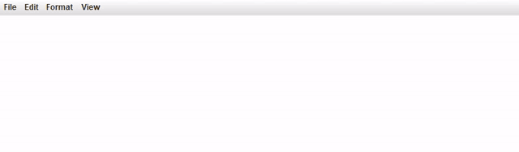
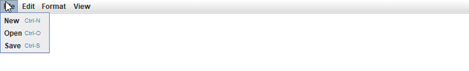
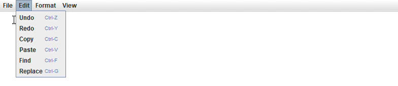
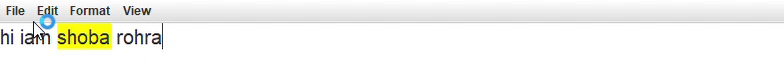

# Notepad (Java Swing)

A simple Notepad-style text editor for the desktop, written in Java with Swing. You can type, open and save text, undo and redo, copy and paste, find a word and replace words, all with keyboard shortcuts.



*The demo is sped up 4 times.*

## Features

- Write and edit text with word wrap and a scroll bar
- **File** menu: New, Open, Save
- **Edit** menu: Undo, Redo, Copy, Paste, Find, Replace
- **Find** highlights the word you search for in yellow
- **Replace** dialog: type the word and the new word, then press Replace or Replace All
- "Are you sure?" question before **New** clears your text
- Keyboard shortcuts for every command (see the table below)
- Window opens in the middle of the screen (800 x 600)

## Screenshots

| File menu | Edit menu |
|---|---|
|  |  |

**Find** highlights the word in yellow:



## Keyboard shortcuts

| Command | Shortcut |
|---|---|
| New | `Ctrl + N` |
| Open | `Ctrl + O` |
| Save | `Ctrl + S` |
| Undo | `Ctrl + Z` |
| Redo | `Ctrl + Y` |
| Copy | `Ctrl + C` |
| Paste | `Ctrl + V` |
| Find | `Ctrl + F` |
| Replace | `Ctrl + G` |

## Requirements

- Java Development Kit (JDK) 8 or newer. The code compiles with JDK 21.

## How to run

**From the terminal**

```bash
git clone https://github.com/Shobar21/Notepad.git
cd Notepad
javac NotePad.java
java NotePad
```

**From IntelliJ IDEA**

Open the project folder, open `NotePad.java` and run the `main` method.

> The file `NotePad.class` in this repository was built with Java 16. If `java NotePad` shows `UnsupportedClassVersionError`, run `javac NotePad.java` first to build it again with your own Java.

## Project files

| File | What it is |
|---|---|
| `NotePad.java` | The whole program: window, menus, file handling, find and replace |
| `StackDemo.java` | A small stack (linked list) class written for an earlier Undo / Redo idea. The editor now uses Java's built-in `UndoManager`, so this file is not used |
| `notepad.jpeg` | Window icon |
| `NotePad.class` | Compiled program |
| `Project.iml`, `.idea/` | IntelliJ IDEA project files |

## How it works

- The text area is a Swing `JTextArea` inside a `JScrollPane`.
- Undo and Redo use `javax.swing.undo.UndoManager`.
- Open and Save use `JFileChooser` with `BufferedReader` and `BufferedWriter`.
- Find uses a `Highlighter` with a yellow painter.
- The Replace window is a `JDialog` with two text fields and three buttons (Replace, Replace All, Cancel).

## Known limits and ideas for later

- **Save** adds the letters `txt` to the end of the file name **without a dot** (`note` becomes `notetxt`). As a trick, type `note.` as the name to get `note.txt`.
- **Open** adds the text of the chosen file after the text already in the window. It does not clear the window first.
- **Replace** matches whole words only, and it rewrites the text with single spaces, so line breaks are lost.
- The window icon path is fixed to a folder on the author's computer (`E:/3rd semester/...`), so the icon shows only there.
- The **Format** and **View** menus are empty for now (ideas: font and size, dark mode, word wrap on and off).
- Ideas: Cut, Select All, a "Save before closing?" question, and a status bar with the word count.

## Author

Shoba Rohra, [@Shobar21](https://github.com/Shobar21)
